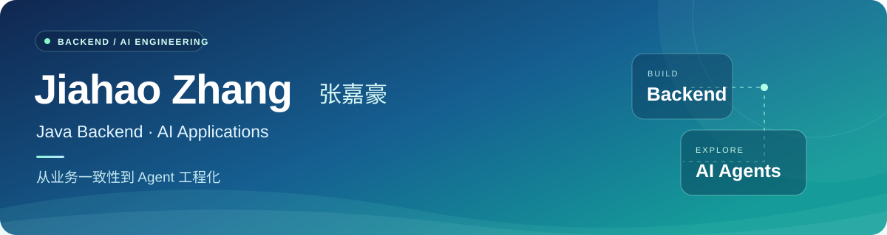

  

  <strong>深圳大学 · 硕士在读</strong> &nbsp; / &nbsp; <strong>2027 届</strong> &nbsp; / &nbsp; <strong>Java 后端 · AI 应用</strong>

  <a href="#-about-me">关于我</a> &nbsp; · &nbsp;
  <a href="#-tech-stack">技术方向</a> &nbsp; · &nbsp;
  <a href="#-selected-projects">项目实践</a>

---

## 👋 About Me

你好，我是 **张嘉豪（Jiahao Zhang）**，目前在深圳大学攻读信息与通信工程硕士，预计于 **2027 年毕业**。

我的主要方向是 **Java 后端开发**，同时关注 **AI 应用的工程化落地**。

- **后端工程：** 关注并发控制、事务边界、幂等与异常排查。
- **Agent 工程：** 关注任务调度、上下文管理、工具调用和可复现评测。
- **实习实践：** 曾在广和通参与 AI Agent 开发，实践研究型 Agent 的检索编排、证据分级和质量评测。

希望通过代码、文档和测试，把实践过程记录下来。

## 🛠️ Tech Stack

**后端与数据**

  

Java · Spring Boot · MySQL · Redis · RocketMQ

**AI 应用**

  

Python · FastAPI · Tool Calling / MCP · RAG · Evaluation

**工程与交付**

  

Docker · Git · React · TypeScript

React / TypeScript 用于配套页面与联调；主要方向仍是后端与 AI 应用。

## 🚀 Selected Projects

<table>
  <tr>
    <td width="100" align="center" valign="top">
      
    </td>
    <td>
      <h3><a href="https://github.com/zhangjiahaoaaa/campus-dash">CampusDash · 校园跑腿交易平台</a></h3>
      
围绕抢单、履约和模拟资金结算展开的 Java 后端实践，在已有教学项目基础上学习与扩展。

      <ul>
        <li><b>并发抢单：</b>Redis Lua 预占、数据库条件更新与唯一约束。</li>
        <li><b>业务一致性：</b>结算事务、幂等控制与异步任务补偿。</li>
        <li><b>运营排障：</b>聚合订单、资金和消息证据，扩展只读 AI 排障能力。</li>
      </ul>
      
<code>Java</code> <code>Spring Boot</code> <code>MySQL</code> <code>Redis</code> <code>RocketMQ</code>

      
<a href="https://github.com/zhangjiahaoaaa/campus-dash"><b>查看源码 →</b></a> &nbsp; · &nbsp; <a href="https://github.com/zhangjiahaoaaa/campus-dash#本地运行基础演示模式">运行说明</a>

    </td>
  </tr>
</table>

  

学习与演示项目，使用模拟资金；完整验证范围见项目 README，不代表生产环境验收。

<table>
  <tr>
    <td width="100" align="center" valign="top">
      
    </td>
    <td>
      <h3>Forge · Agent Harness 工程实践</h3>
      
面向多轮复杂任务，探索 Agent 运行时的调度、上下文和工具执行机制。

      <ul>
        <li><b>任务调度：</b>会话级串行调度与跨会话并发。</li>
        <li><b>上下文管理：</b>预算化上下文组装与长期记忆接入。</li>
        <li><b>工具与评测：</b>安全工具并行、执行追踪与可复现评测。</li>
      </ul>
      
<code>Python</code> <code>asyncio</code> <code>Tool Calling / MCP</code> <code>Evaluation</code>

      
此处展示项目实践，暂不提供公开源码链接。

    </td>
  </tr>
</table>

## 💼 Internship

**广和通 · AI Agent 实习** &nbsp; | &nbsp; 2026.05 – 2026.07

**Deep Researcher · 企业研究 Agent**

在企业研究场景中，参与检索编排、证据可信度分级与报告质量评测，关注研究结论能否追溯到可靠来源。

- **检索编排：** 任务识别、查询增强、官方域名检索与多源搜索。
- **证据链路：** 来源分级、Metadata 传递与高可信证据保留。
- **质量评测：** 业务 Query 样本、确定性规则验收与执行追踪。

仅展示实习职责概述，不提供企业源码、内部数据或材料。

---

  把设计讲清楚，把边界写明白，把结果交给验证。

